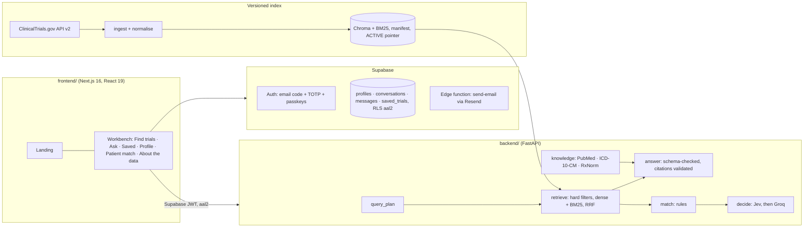

# Orvant (NexTrial): evidence-traceable clinical-trial discovery

Orvant helps people and clinicians find recruiting **cancer trials** on ClinicalTrials.gov and see **why** each one
came up, criterion by criterion, with the registry text and the patient fact behind every finding.

> **Not an eligibility decision.** Every match label ends in "review required". Results must be checked against the
> current ClinicalTrials.gov record with a clinician. Orvant is not clinically validated.

---

## What it does

| Area | What you get |
|---|---|
| **Find trials** | One plain-language box. A deterministic query plan reads phase, status, age, sex, stage, biomarkers, location and NCT IDs as **hard filters**; dense (PubMedBERT) + BM25 retrieval with reciprocal-rank fusion ranks what passes. An impossible filter returns nothing, never an unfiltered fallback. |
| **Ask** | Chat over the trial index with numbered, inline citations. Every quote is checked against the retrieved registry text. Optional external knowledge, each labelled and kept apart from registry facts: **PubMed** abstracts (NCBI E-utilities, switch on per device), **ICD-10-CM** codes (NLM Clinical Tables, for coding questions), **RxNorm** generic names for brands named as prior therapy (NLM RxNav). Answer models: Gemini, Groq, Hugging Face or OpenRouter. |
| **Patient match** | Match **yourself** (from your profile) or a synthetic patient. Each inclusion/exclusion criterion is judged **Met / Not met / Unknown / Not applicable** with evidence. Rules decide age, sex, ECOG and simple lab thresholds; an optional selective judge (TypeSafe **Jev**, then **Groq**) may decide the rest only when it quotes a patient fact word for word. Unknown never counts as a match. |
| **Saved trials & history** | Bookmarks and Ask conversations stored per account in Supabase. |
| **Accounts** | Supabase Auth: passwordless email code, mandatory authenticator-app second factor (aal2), optional passkey / fingerprint sign-in. Health data is readable only from a two-factor session. |

### What it is not

- Not an eligibility decision, and the trial score is a **share of criteria satisfied**, not a probability.
- Not live: registry facts come from one dated snapshot, shown on every screen.
- Narrow by design: eight cancer types (breast, lung, melanoma, colorectal, prostate, pancreatic, leukemia, ovarian),
  recruiting trials only, up to 250 per condition.
- External sources (PubMed, ICD-10-CM, RxNorm) are for Ask only. They never change a match result.

---

## Architecture



- **Ingestion** (`backend/ingest.py`, `backend/build.py`): API v2 with `nextPageToken`, immutable raw snapshots,
  normalisation, de-duplication by NCT ID, section chunks with factual headers, smoke checks, then an atomic switch of
  the `ACTIVE` index pointer. A stale index refuses to load.
- **Generation** (`backend/answer.py`): structured output; citations, quotes, PMIDs and ICD codes not found in the
  retrieved evidence are dropped and reported as limitations.
- **Matching** (`backend/match.py`, `backend/decide.py`): rules first; Jev for bounded decisions at confidence ≥ 0.9
  with a verbatim fact; Groq for high-risk, ambiguous or low-confidence criteria; disagreement stays Unknown. A failed
  judge returns an error, never a half-judged result. Logs hold no patient facts.
- **Privacy**: profile name, birth year, email and place never reach a judge or an outside search. Only topic words
  (ages, places, pronouns, emails and long numbers removed) go to NCBI / NLM, called directly, with no third-party
  hosted MCP server in between.

---

## Repository layout

```
backend/                 FastAPI API, ingestion, retrieval, matching, evaluation (Python 3.11)
  api.py                 /health, /api/stats, /api/search, /api/match, /api/chat
  ingest.py · build.py   ClinicalTrials.gov snapshot → normalised records → versioned index
  index.py · retrieve.py Chroma (PubMedBERT) + BM25, hard filters, reciprocal-rank fusion
  query_plan.py          deterministic QueryPlan parsing
  answer.py              answer models, citation validation
  knowledge.py           PubMed, ICD-10-CM, RxNorm (chat only)
  match.py · decide.py · labs.py   criterion matcher, selective judge, lab comparisons
  evaluate*.py · bm25_experiment.py   evaluation harnesses
  streamlit_app.py       developer workbench (query plan, retrieval trace, evaluation)
  tests/                 offline test suite
  EVALUATION.md · SCORING.md · TASKS.md
  requirements.txt · requirements.lock
frontend/                Next.js app (landing, auth, workbench)
  app/ · components/ · lib/ · assets/
data/patients/processed/patients.json   synthetic patients (no real people)
changelog.md             step-by-step record of every change
```

---

## Running it locally

### Prerequisites
- Python 3.11, Node.js 20+
- A Supabase project (Auth with TOTP MFA enabled)
- API keys only for the features you turn on (see below)

### 1. Backend

```bash
python3.11 -m venv .venv && source .venv/bin/activate
pip install -r backend/requirements.txt          # or backend/requirements.lock for the exact tested set
```

Create `.env` in the project root (never commit it):

| Variable | Needed for |
|---|---|
| `SUPABASE_URL` | verifying sign-in tokens against the project's published keys (or set `SUPABASE_JWT_SECRET`) |
| `CORS_ORIGINS` | the frontend origin(s), comma-separated, e.g. `http://localhost:3000` |
| `GOOGLE_API_KEY` | Gemini answers in Ask |
| `GROQ_API_KEYS`, `GROQ_MODEL` | Groq answers in Ask, and the escalation judge in Patient match |
| `HF_API_KEYS`, `HF_MODEL` · `OPENROUTER_API_KEY`, `OPENROUTER_MODEL` | optional extra answer models |
| `PUBMED_EMAIL`, `NCBI_API_KEY` | PubMed in Ask (key raises NCBI's limit from 3 to 10 requests/s) |
| `TYPESAFE_API_KEY` | Jev, the selective judge |
| `NEXTRIAL_ALLOW_PAID_JUDGES=1` | switches the paid selective judge on (off by default) |

Build the index (fetches ClinicalTrials.gov, about 2,000 studies), then start the API:

```bash
python -m backend.build                 # --per-condition N, or --snapshot <id> to reuse a raw snapshot
uvicorn backend.api:app --reload --port 8000
streamlit run backend/streamlit_app.py  # optional developer workbench
```

### 2. Supabase

The database schema, its migrations and the email function are kept outside this repository; ask the maintainer
for them. The project needs:

- **Auth:** email one-time codes (6 digits), TOTP multi-factor authentication and passkeys enabled.
- **Tables** in `public`, each with row-level security that allows only the owner and only from a two-factor (`aal2`)
  session: `profiles` (one row per account, filled from the sign-up metadata by a trigger), `conversations`,
  `messages` and `saved_trials`.
- **Email:** an Auth "Send Email" hook that sends the sign-up and sign-in codes (the current setup uses Resend).

### 3. Frontend

```bash
cd frontend
npm install
```

`frontend/.env.local`:

```
NEXT_PUBLIC_API_URL=http://localhost:8000
NEXT_PUBLIC_SUPABASE_URL=...
NEXT_PUBLIC_SUPABASE_ANON_KEY=...
```

```bash
npm run dev     # http://localhost:3000
```

---

## API

| Route | Auth | Purpose |
|---|---|---|
| `GET /health` | none | status, index version, registry data timestamp, snapshot age |
| `GET /api/stats` | none | index counts, models, configured chat providers, whether paid judges are on |
| `POST /api/search` | aal2 token | query plan + hybrid retrieval with hard filters |
| `POST /api/match` | aal2 token | criterion findings for your own `profile` or a synthetic `patient_id`; `judge: "selective"` needs the paid-judge opt-in |
| `POST /api/chat` | aal2 token | cited answer from the index; `literature: true` adds PubMed; returns `sources`, `articles`, `codes`, `drugs`, `limitations` |

Every response carries `clinical_review_required: true` and the snapshot's freshness.

---

## Evaluation (honest numbers)

Measured against TrialGPT's public physician criterion annotations on **synthetic** patients, with a patient-level
dev / held-out split (no patient on both sides). Full method and caveats: `backend/EVALUATION.md`.

| Held-out, rules + Jev (run once, 2026-10-14) | Result |
|---|---|
| Criteria decided | 52 of 489 (10.6% coverage) |
| Agreement with physicians when decided | 50 of 52 (96.2%, 95% CI 87.0–98.9%) |
| False inclusions / false exclusions | 0 / 1 |
| Jev confidence calibration | ECE 0.28: 0.9 does **not** mean "90% right" |

The escalation judge was not measured on held-out data (Gemini returned 503; Groq has not been evaluated yet).
These figures show behaviour on short synthetic vignettes, not reliability on real clinical records.

---

## Tests

```bash
python -m pytest backend/tests -q                         # offline, vendors mocked
cd frontend && npx tsc --noEmit && node lib/tidy.check.ts
```

---

## Data sources and attribution

- **ClinicalTrials.gov** API v2 (U.S. National Library of Medicine).
- **PubMed** via NCBI E-utilities; abstracts may carry publisher copyright and are linked and quoted briefly.
- **ICD-10-CM** via NLM Clinical Tables; **RxNorm** via NLM RxNav. This product uses publicly available data from the
  U.S. National Library of Medicine (NLM), National Institutes of Health; NLM does not endorse it.
- Evaluation corpora: CHIA and Leaf Clinical Trials (CC BY 4.0), TrialGPT criterion annotations.
- ICD-11 and SNOMED CT are deliberately not integrated until the target market and licensing are settled.

---

## Status

Work is tracked in `backend/TASKS.md` against the original correctness-first blueprint, and every change is recorded
in `changelog.md`. Open items include deploying the API, scheduled ingestion with rollback, rate limiting, secret
scanning, a clinician-adjudicated evaluation set and a held-out run of the escalation judge.

## License

No license has been chosen yet; until one is added, all rights are reserved.

## Author

**Nirman Patel**: [nirmanhere.vercel.app](https://nirmanhere.vercel.app) · [GitHub @NirmanPatel036](https://github.com/NirmanPatel036) · [LinkedIn](https://linkedin.com/in/nirmanpatel) · nirman0511@gmail.com
